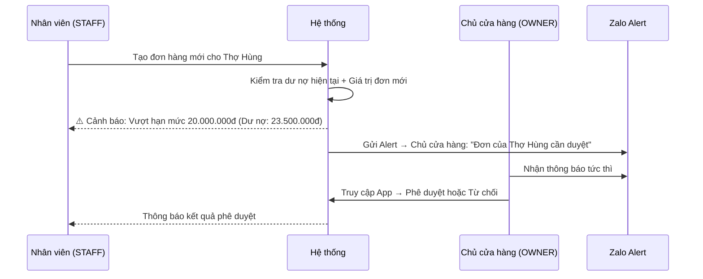
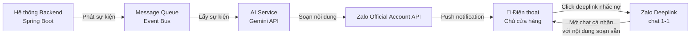
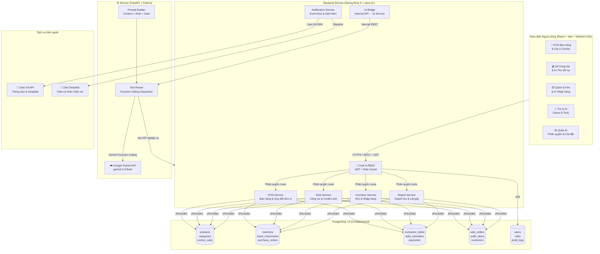
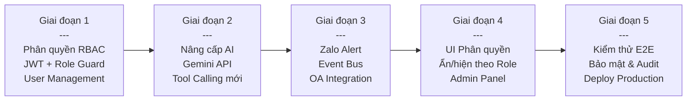

# TÀI LIỆU ĐẶC TẢ KỸ THUẬT & NGHIỆP VỤ (SRS) — v2.0
## HỆ THỐNG TRỢ LÝ AI QUẢN LÝ VẬN HÀNH CỬA HÀNG ĐIỆN NƯỚC & THIẾT BỊ VỆ SINH
*(AI Operations Assistant for Hardware, Electrical & Sanitary Ware Retailers)*

> **Cập nhật v2.0** — 06/11/2026: Bổ sung phân quyền Chủ cửa hàng / Nhân viên; Chuyển AI Engine sang **Gemini API**; Thêm chức năng **Zalo Thông báo Thông minh** cho chủ cửa hàng.

---

## 1. TỔNG QUAN DỰ ÁN & BỐI CẢNH

### 1.1. Bối cảnh & Thách thức đặc thù của Cửa hàng Điện Nước

Các cửa hàng bán lẻ và đại lý vật liệu điện nước, thiết bị vệ sinh (Lavabo, bồn cầu, sen vòi, ống PVC/PPR, dây cáp điện, phụ kiện fitting...) có đặc thù vận hành hoàn toàn khác biệt so với bán lẻ tiêu dùng thông thường:

1. **Công nợ chiếm tỷ trọng cực lớn**: Khách hàng chủ yếu là Thợ điện nước, Nhà thầu xây dựng và Chủ nhà hoàn thiện công trình — ứng trước vật tư, thanh toán theo giai đoạn hoặc khi công trình nghiệm thu. Nếu không quản lý chặt, dòng tiền cửa hàng bị đứt gãy.
2. **Kho hàng phức tạp — đa đơn vị, biến động giá**: Hàng nghìn mã phụ kiện (co, lơ, tê, rắc co), dây điện bán theo mét/cuộn, gạch men theo m²/thùng; mỗi mã có đơn vị quy đổi, hạn tồn an toàn và nhà cung cấp riêng.
3. **Bài toán tư vấn Combo Thiết bị Vệ sinh**: Khách mua Lavabo luôn kèm: vòi, xi-phông, van góc, keo silicon, gạch ốp lát phối màu — nhân viên mới hay quên tư vấn phụ kiện đi kèm, khách phải chạy lại mua bổ sung.

### 1.2. Mục tiêu hệ thống

| Trụ cột | Mô tả |
|---------|-------|
| **Quản lý Công nợ thông minh** | Phân tích tuổi nợ, hạn mức tín dụng thợ/nhà thầu, AI sinh kịch bản nhắc nợ gửi Zalo |
| **AI Restock Copilot** | Dự báo tồn kho, cảnh báo nhập hàng, tự động tạo Phiếu Nhập nháp theo NCC |
| **Recommend Engine Combo** | Gợi ý phối màu gạch men + phụ kiện bắt buộc khi bán Thiết bị Vệ sinh |
| **Trợ lý AI Điều hành** | Chat giọng nói & văn bản, gọi Tool tự động tra dữ liệu kinh doanh thời gian thực |
| **Zalo Alert Thông minh** | Thông báo chủ động qua Zalo khi phát sinh sự kiện quan trọng |

---

## 2. PHÂN QUYỀN HỆ THỐNG (RBAC)

### 2.1. Hai vai trò chính

| Tiêu chí | 👑 Chủ cửa hàng (`OWNER`) | 🧑‍💼 Nhân viên (`STAFF`) |
|----------|--------------------------|------------------------|
| **Mục đích** | Điều hành & giám sát toàn diện | Vận hành tác nghiệp hàng ngày |
| **Số lượng tài khoản** | 1–2 (chủ / kế toán trưởng) | Nhiều (thu ngân, kho, bán hàng) |
| **Xem Báo cáo tài chính** | ✅ Toàn bộ: doanh thu, lãi gộp, giá vốn | ❌ Chỉ xem tổng đơn trong ca làm |
| **Xem Công nợ** | ✅ Toàn bộ danh sách & số tiền | ⚠️ Chỉ xem tên & trạng thái (ẩn số tiền tuyệt đối) |
| **Phê duyệt Đơn vượt hạn mức nợ** | ✅ Phê duyệt / Từ chối | ❌ Chỉ được tạo đơn, không phê duyệt |
| **Thiết lập Hạn mức Tín dụng (Credit Limit)** | ✅ Tạo / Sửa / Xóa | ❌ Chỉ đọc |
| **Duyệt Phiếu Nhập hàng (PO)** | ✅ Duyệt & Xác nhận | ❌ Chỉ tạo nháp, không được duyệt |
| **Xem Giá vốn & Lãi gộp sản phẩm** | ✅ Toàn bộ | ❌ Ẩn hoàn toàn, chỉ thấy giá bán |
| **Quản lý Danh mục sản phẩm** | ✅ Thêm / Sửa / Xóa / Đặt giá | ⚠️ Chỉ tra cứu & điều chỉnh tồn kho (nhập kho) |
| **Quản lý tài khoản & Nhân viên** | ✅ Tạo tài khoản nhân viên, đặt lại mật khẩu | ❌ Không có quyền này |
| **Gửi tin nhắc nợ Zalo** | ✅ Toàn bộ | ⚠️ Chỉ được gửi nhắc nợ mức GENTLE (nhẹ nhàng) |
| **Sử dụng Trợ lý AI** | ✅ Toàn bộ: báo cáo, kho, nợ, tư vấn | ⚠️ Chỉ: tra tồn kho, tư vấn combo sản phẩm |
| **Nhận Zalo Alert thông báo** | ✅ Nhận toàn bộ cảnh báo quan trọng | ❌ Không nhận thông báo hệ thống |
| **Xem Lịch sử log hoạt động** | ✅ Xem log toàn bộ nhân viên | ⚠️ Chỉ xem lịch sử của chính mình |
| **Xuất dữ liệu (Export CSV/Excel)** | ✅ Báo cáo, kho, nợ, lịch sử giao dịch | ❌ Không có quyền này |

### 2.2. Ma trận phân quyền theo module

```
Module              │ OWNER │ STAFF │
─────────────────────┼───────┼───────┤
POS Bán hàng         │  R/W  │  R/W  │  (Nhân viên bán hàng bình thường)
Quản lý Kho          │  R/W  │  R    │  (Nhân viên chỉ nhập kho, không xóa)
Danh mục Sản phẩm    │  R/W  │  R    │
Báo cáo Doanh thu    │  R/W  │  —    │  (Ẩn hoàn toàn với nhân viên)
Báo cáo Lãi gộp      │  R/W  │  —    │
Sổ Công nợ           │  R/W  │  R*   │  (* Ẩn số tiền tuyệt đối)
Phê duyệt Đơn nợ     │  W    │  —    │
Phiếu Nhập hàng (PO) │  R/W  │  R    │  (Nhân viên tạo nháp, chủ duyệt)
Trợ lý AI Báo cáo    │  R/W  │  —    │
Trợ lý AI Kho/Combo  │  R/W  │  R/W  │
Zalo Alert           │  R    │  —    │
Quản lý Nhân viên    │  R/W  │  —    │
```

### 2.3. Luồng xử lý khi vượt hạn mức nợ



---

## 3. TÍNH NĂNG CHI TIẾT TỪNG PHÂN HỆ

### 3.1. Phân hệ Bán hàng & Thu ngân (POS)

#### 3.1.1. Bán hàng đa đơn vị tính & Cắt lẻ linh hoạt
- Mỗi sản phẩm có **2 lớp đơn vị tính**:
  - **Đơn vị kho (Base Unit)**: Cuộn, Cây, Thùng, Túi — dùng để quản lý tồn kho.
  - **Đơn vị bán lẻ (Sell Unit)**: Mét, Cái, m² — dùng để bán trực tiếp cho khách.
- Hệ số quy đổi: 1 Cuộn CADIVI = 100m; 1 Cây ống Tiền Phong = 4m; 1 Thùng gạch 60x60 = 4 viên = 1,44m².
- Khi thu ngân chọn số lượng bán lẻ (ví dụ: 25m dây điện), hệ thống tự động trừ 0.25 cuộn khỏi tồn kho.
- **Cảnh báo tồn thấp theo đơn vị kho**: Khi tồn kho cơ sở < ngưỡng an toàn, hiển thị badge đỏ ở màn hình POS.

#### 3.1.2. Quản lý & Kiểm soát công nợ Thợ/Thầu
- Thiết lập hạn mức công nợ tối đa (Credit Limit) cho từng khách hàng (chỉ OWNER mới được thiết lập).
- Tính toán dư nợ theo thời gian thực: `Dư nợ hiện tại = Tổng đơn chưa thanh toán − Các lần trả trước`.
- **Cơ chế chốt chặn 3 cấp**:
  - **Cấp 1 (Vàng)**: Dư nợ ≥ 80% hạn mức → Cảnh báo nhân viên nhưng vẫn cho xuất đơn.
  - **Cấp 2 (Cam)**: Dư nợ ≥ 100% hạn mức → Chặn xuất đơn, hiển thị popup yêu cầu phê duyệt OWNER.
  - **Cấp 3 (Đỏ)**: Dư nợ quá hạn > 30 ngày → Chặn hoàn toàn, bắt buộc OWNER phải mở khóa thủ công.
- Trigger Zalo Alert tức thì đến OWNER khi đơn chạm Cấp 2 hoặc Cấp 3.

#### 3.1.3. Gợi ý Combo Thiết bị Vệ sinh tại POS (Recommend Engine)
- Khi thu ngân chọn 1 mặt hàng thuộc nhóm **Thiết bị Vệ sinh** (SANITARY_WARE), ngăn kéo gợi ý tự động mở ra:
  - Hiển thị danh sách phụ kiện bắt buộc (Mandatory Kit) và phụ kiện gợi ý (Recommended Accessories).
  - Nhân viên check vào để thêm nhanh vào đơn hàng.
  - Nút **"Thêm trọn Combo (Tiết kiệm 5%)"**.
- Dữ liệu gợi ý dựa trên `combo_recommendation_rules` trong CSDL, do OWNER thiết lập.

#### 3.1.4. Ghi nhận thanh toán & In hóa đơn
- Hỗ trợ: Tiền mặt, Chuyển khoản ngân hàng, Thanh toán một phần (Ghi nợ sổ).
- In hóa đơn A5/A4 hoặc hóa đơn nhiệt (thermal receipt).
- Lưu lịch sử toàn bộ giao dịch có dấu thời gian và tên nhân viên thực hiện.

---

### 3.2. Phân hệ Quản lý Kho & Nhập hàng thông minh

#### 3.2.1. Danh mục sản phẩm & Tồn kho an toàn
- Phân loại sản phẩm theo 7 nhóm ngành: `ELECTRICAL`, `PLUMBING`, `SANITARY_WARE`, `BATHROOM_FITTINGS`, `TILES_FLOORING`, `HARDWARE_TOOLS`, `WATER_HEATER_PUMP`.
- Thiết lập định mức tồn kho:
  - **Min Stock (Tồn tối thiểu)**: Ngưỡng kích hoạt cảnh báo nhập hàng.
  - **Max Stock (Tồn tối đa)**: Tránh tồn đọng vốn chết.
- Tự động phân loại:
  - **Hàng sắp hết**: Tồn kho ≤ Min Stock.
  - **Hàng bán chậm (Slow-moving)**: Không có giao dịch xuất kho trong 60 ngày liên tiếp.
  - **Hàng tồn đọng vốn**: Giá trị hàng tồn kho cao mà tốc độ bán ≤ 1 đơn/tháng.

#### 3.2.2. AI Restock Copilot (Kế hoạch nhập hàng tự động)
- **Trigger tự động**: Mỗi đêm hoặc khi tồn kho bất kỳ sản phẩm chạm Min Stock.
- **Thuật toán dự báo**:
  - Tính **Tốc độ bán trung bình 14 ngày** (Burn Rate = Tổng xuất 14 ngày ÷ 14).
  - Ước lượng **Số ngày tồn còn lại** = Tồn hiện tại ÷ Burn Rate.
  - Đề xuất **Số lượng cần đặt** = Max Stock − Tồn hiện tại (tối thiểu đủ dùng 30 ngày).
- **Gom đơn theo Nhà cung cấp (NCC)**:
  - Tự động nhóm các sản phẩm cần nhập theo NCC chính (Cadivi, Tiền Phong, Inax, ...).
  - Tạo **Draft Purchase Order (PO nháp)** cho từng NCC với tên sản phẩm, số lượng, đơn giá tham chiếu gần nhất.
  - OWNER nhận Zalo Alert → Vào App xem và duyệt PO chỉ với 1 click.

#### 3.2.3. Lịch sử nhập kho & Điều chỉnh tồn
- Nhân viên kho ghi nhận nhập hàng theo Phiếu Nhập được OWNER duyệt.
- Hỗ trợ điều chỉnh tồn kho (Inventory Adjustment) với lý do bắt buộc: Hàng lỗi/hỏng, Kiểm kê chênh lệch, Hàng mẫu trưng bày.
- Mọi điều chỉnh đều tạo log truy vết (Audit Log) ghi tên nhân viên, thời gian, lý do.

---

### 3.3. Phân hệ Tài chính, Báo cáo & Thu hồi nợ *(Chỉ OWNER)*

#### 3.3.1. Báo cáo kinh doanh đa chiều
- **Báo cáo Doanh thu & Lãi gộp** (theo ngày / tuần / tháng / quý / khoảng ngày tùy chỉnh):
  - Doanh thu thuần, Giá vốn hàng bán (COGS), Lợi nhuận gộp, Tỷ suất lãi gộp (Gross Margin %).
- **Báo cáo Top sản phẩm**: Top 10 sản phẩm bán chạy nhất và Top 10 sản phẩm bán chậm nhất.
- **Báo cáo theo Nhân viên**: Doanh số từng nhân viên trong ca / ngày.
- **Xuất Excel/CSV**: Cho tất cả báo cáo tài chính.

#### 3.3.2. Sổ Công nợ & AI Thu hồi nợ
- **Bảng tổng hợp công nợ**: Danh sách thợ/thầu, tổng nợ, số ngày quá hạn, mức rủi ro (`LOW / MEDIUM / HIGH / CRITICAL`).
- **Phân tích tuổi nợ (Debt Aging)**: Nhóm nợ theo < 30 ngày / 30–60 ngày / > 60 ngày.
- **AI sinh kịch bản nhắc nợ 4 cấp độ**:

| Cấp độ | Trigger | Giọng văn |
|--------|---------|-----------|
| `GENTLE` | Nợ < 15 ngày | Thân thiện, nhắc nhẹ nhàng như bạn bè |
| `MILESTONE_CHECK` | 15–30 ngày | Hỏi thăm tiến độ công trình, gợi ý thanh toán một phần |
| `URGENT_NOTICE` | 30–60 ngày | Rõ ràng, nêu số tiền cụ thể, hạn thanh toán |
| `FINAL_WARNING` | > 60 ngày | Cứng rắn, nêu hậu quả dừng cấp hàng |

- **Gửi nhắc nợ 1-click qua Zalo cá nhân** (deeplink mở Zalo với nội dung AI soạn sẵn, người dùng chỉ cần nhấn Gửi).

---

### 3.4. Phân hệ Zalo Thông báo Thông minh *(Chủ cửa hàng — OWNER)*

> **Tính năng mới v2.0** — Hệ thống chủ động gửi thông báo quan trọng về Zalo cá nhân của chủ cửa hàng mà không cần phải mở App.

#### 3.4.1. Các loại thông báo Zalo Alert

| Loại Alert | Trigger | Nội dung mẫu |
|-----------|---------|-------------|
| 🚨 **Đơn vượt hạn mức nợ** | Nhân viên tạo đơn, khách vượt Credit Limit | *"⚠️ Thợ Hùng (Nợ: 23.5tr/HM: 20tr) vừa tạo đơn 3.200.000đ. Cần duyệt ngay."* |
| 📦 **Hàng sắp hết kho** | Tồn ≤ Min Stock | *"📦 3 mặt hàng sắp hết kho cần đặt gấp: Ống PPR Tiền Phong phi 21, Dây CADIVI 2x2.5, Van góc inox. Xem chi tiết?"* |
| 💰 **Tổng kết doanh thu cuối ngày** | Hàng ngày lúc 21:00 | *"📊 Doanh thu hôm nay: 18.400.000đ | Lãi gộp: 4.600.000đ (25%). Xuất 47 đơn — Tốt hơn hôm qua 12%."* |
| ⚠️ **Nợ quá hạn nghiêm trọng** | Nợ > 60 ngày | *"🔴 Công nợ NGUY HIỂM: Nhà thầu Kiến Á quá hạn 72 ngày (45tr). Cần liên hệ gấp hoặc tạm dừng cấp hàng."* |
| 🛒 **PO nháp cần duyệt** | AI Restock tạo PO mới | *"🛒 AI đề xuất nhập hàng từ 2 NCC: Cadivi (3 mặt hàng) & Tiền Phong (5 mặt hàng). Tổng ước tính: 12.800.000đ. Duyệt?"* |
| 👤 **Hoạt động bất thường** | Điều chỉnh tồn kho lớn / Hủy đơn lớn | *"⚠️ Nhân viên Minh vừa điều chỉnh giảm tồn kho 50 cuộn CADIVI lúc 14:35. Lý do: Kiểm kê. Xem log?"* |
| 📅 **Báo cáo tuần** | Mỗi thứ 2 lúc 8:00 | Tóm tắt doanh thu, lãi gộp, top sản phẩm, công nợ mới phát sinh trong tuần. |

#### 3.4.2. Cơ chế tích hợp Zalo



- **Luồng thông báo hệ thống**: Backend phát sự kiện → AI Service (Gemini) soạn nội dung ngắn gọn → Gửi qua Zalo Official Account API → Chủ cửa hàng nhận notification trên điện thoại.
- **Luồng nhắc nợ cá nhân**: OWNER click nút → Hệ thống tạo Zalo deeplink với nội dung AI soạn sẵn → Mở Zalo cá nhân và chat trực tiếp với thợ/thầu.
- **Cấu hình tắt/bật**: OWNER có thể tùy chỉnh từng loại Alert nào muốn nhận trong mục Cài đặt.

---

### 3.5. Trợ lý AI Điều hành (AI Operations Assistant)

> **v2.0**: Chuyển hoàn toàn sang **Google Gemini API** (`gemini-2.0-flash`) thay thế Ollama Local.

#### 3.5.1. Kiến trúc AI mới — Gemini API

| Thuộc tính | Ollama Local (Cũ) | Gemini API (Mới) |
|-----------|-------------------|-----------------|
| **Model** | `qwen2.5:3b` | `gemini-2.0-flash` |
| **Function Calling** | ⚠️ Yếu, cần Hybrid Router bù | ✅ Native, chính xác cao |
| **Latency** | 5–8 giây | ≤ 1–2 giây |
| **Ngôn ngữ Tiếng Việt** | ⚠️ Đôi khi lọt tiếng Trung | ✅ Xuất sắc, tự nhiên |
| **Context Window** | 4,096 tokens | 1,000,000 tokens |
| **Chi phí** | Miễn phí (Local) | Pay-per-use (Gemini API) |
| **Độ tin cậy Tool Calling** | ~70% | ~98% |

#### 3.5.2. Giao diện tương tác (Voice & Text Chat)
- Nhận lệnh bằng **giọng nói tiếng Việt** (Speech-to-Text) hoặc **gõ văn bản** trực tiếp.
- Thanh trạng thái tiến trình (Status Progress Bar) hiển thị: *Tiếp nhận → Nhận diện ý định → Truy vấn dữ liệu → Tổng hợp*.
- Render kết quả dạng **bảng Markdown** và **biểu đồ** chuyên nghiệp.

#### 3.5.3. Các Tool AI có thể gọi theo phân quyền

| Tool | Mô tả | OWNER | STAFF |
|------|-------|-------|-------|
| `get_revenue_report` | Doanh thu, lãi gộp theo kỳ | ✅ | ❌ |
| `get_debt_summary` | Tổng quan công nợ, nợ quá hạn | ✅ | ❌ |
| `get_low_stock_alerts` | Danh sách hàng sắp hết kho | ✅ | ✅ |
| `get_slow_moving_products` | Hàng bán chậm, tồn đọng | ✅ | ✅ |
| `get_top_products` | Top sản phẩm bán chạy | ✅ | ❌ |
| `generate_restock_plan` | Kế hoạch nhập hàng AI | ✅ | ❌ |
| `recommend_combo` | Tư vấn combo TBVS & gạch men | ✅ | ✅ |
| `draft_debt_reminder` | Soạn tin nhắc nợ | ✅ | ⚠️ GENTLE only |

#### 3.5.4. Ví dụ câu hỏi tự nhiên & AI tự động xử lý

| Câu hỏi người dùng | Tool được gọi | AI phân quyền |
|--------------------|--------------|--------------|
| *"Doanh thu tháng này bao nhiêu?"* | `get_revenue_report(month=current)` | OWNER only |
| *"Hàng nào sắp hết cần đặt?"* | `get_low_stock_alerts()` | OWNER + STAFF |
| *"Thợ Hùng còn nợ bao nhiêu?"* | `get_debt_summary(customer="Hùng")` | OWNER only |
| *"Tư vấn combo lavabo sứ trắng"* | `recommend_combo(type="lavabo", color="trắng")` | OWNER + STAFF |
| *"Viết tin nhắc nợ cho anh Hùng"* | `draft_debt_reminder(customer="Hùng", level="GENTLE")` | OWNER + STAFF* |
| *"Lên kế hoạch nhập hàng tuần này"* | `generate_restock_plan()` | OWNER only |

---

## 4. KIẾN TRÚC HỆ THỐNG TỔNG THỂ (v2.0)



---

## 5. THIẾT KẾ CƠ SỞ DỮ LIỆU

### 5.1. Bảng Users & Phân quyền

```sql
CREATE TABLE users (
    id          BIGSERIAL PRIMARY KEY,
    username    VARCHAR(50) UNIQUE NOT NULL,
    password    VARCHAR(255) NOT NULL,       -- BCrypt hash
    full_name   VARCHAR(100),
    phone       VARCHAR(20),
    role        VARCHAR(20) NOT NULL CHECK (role IN ('OWNER', 'STAFF')),
    is_active   BOOLEAN DEFAULT TRUE,
    zalo_user_id VARCHAR(50),               -- Liên kết Zalo OA để nhận Alert
    created_at  TIMESTAMP DEFAULT NOW(),
    updated_at  TIMESTAMP DEFAULT NOW()
);

CREATE TABLE audit_logs (
    id          BIGSERIAL PRIMARY KEY,
    user_id     BIGINT REFERENCES users(id),
    action      VARCHAR(100) NOT NULL,       -- CREATE_ORDER, ADJUST_STOCK, APPROVE_PO,...
    entity_type VARCHAR(50),                -- ORDER, INVENTORY, DEBT,...
    entity_id   BIGINT,
    old_value   JSONB,
    new_value   JSONB,
    note        TEXT,
    created_at  TIMESTAMP DEFAULT NOW()
);
```

### 5.2. Bảng Sản phẩm & Phụ kiện đặc tả kỹ thuật

```sql
ALTER TABLE products ADD CONSTRAINT products_product_type_check
CHECK (product_type IN (
    'ELECTRICAL', 'PLUMBING', 'SANITARY_WARE',
    'BATHROOM_FITTINGS', 'TILES_FLOORING', 'HARDWARE_TOOLS', 'WATER_HEATER_PUMP'
));

CREATE TABLE product_specifications (
    id                BIGSERIAL PRIMARY KEY,
    product_id        BIGINT REFERENCES products(id) ON DELETE CASCADE,
    color             VARCHAR(50),
    material          VARCHAR(100),
    dimensions        VARCHAR(100),
    voltage_power     VARCHAR(50),
    finish_style      VARCHAR(50),
    installation_type VARCHAR(100),
    created_at        TIMESTAMP DEFAULT NOW()
);

CREATE TABLE combo_recommendation_rules (
    id                       BIGSERIAL PRIMARY KEY,
    rule_name                VARCHAR(255) NOT NULL,
    trigger_product_type     VARCHAR(50) NOT NULL,
    trigger_color            VARCHAR(50),
    recommended_product_id   BIGINT REFERENCES products(id),
    recommended_category_id  BIGINT REFERENCES categories(id),
    recommended_role         VARCHAR(50) NOT NULL,
    recommendation_reason    TEXT,
    priority_score           INT DEFAULT 1,
    is_active                BOOLEAN DEFAULT TRUE,
    created_at               TIMESTAMP DEFAULT NOW()
);
```

### 5.3. Bảng Công nợ & Nhắc nợ

```sql
CREATE TABLE contractor_debts (
    id               BIGSERIAL PRIMARY KEY,
    partner_type     VARCHAR(20) NOT NULL
                     CHECK (partner_type IN ('CONTRACTOR','ELECTRICIAN_PLUMBER','HOMEOWNER','SUPPLIER')),
    customer_id      BIGINT REFERENCES customers(id),
    order_id         BIGINT REFERENCES sale_orders(id),
    project_name     VARCHAR(255),
    total_amount     NUMERIC(15,2) NOT NULL,
    paid_amount      NUMERIC(15,2) DEFAULT 0,
    remaining_amount NUMERIC(15,2) NOT NULL,
    credit_limit     NUMERIC(15,2) DEFAULT 20000000,
    due_date         DATE NOT NULL,
    status           VARCHAR(20) DEFAULT 'ACTIVE'
                     CHECK (status IN ('ACTIVE','OVERDUE','PARTIAL','SETTLED','BAD_DEBT')),
    overdue_days     INT DEFAULT 0,
    risk_level       VARCHAR(20) DEFAULT 'LOW'
                     CHECK (risk_level IN ('LOW','MEDIUM','HIGH','CRITICAL')),
    created_at       TIMESTAMP DEFAULT NOW(),
    updated_at       TIMESTAMP DEFAULT NOW()
);

CREATE TABLE debt_reminders (
    id                 BIGSERIAL PRIMARY KEY,
    debt_id            BIGINT REFERENCES contractor_debts(id) ON DELETE CASCADE,
    reminder_level     VARCHAR(20)
                       CHECK (reminder_level IN ('GENTLE','MILESTONE_CHECK','URGENT_NOTICE','FINAL_WARNING')),
    channel            VARCHAR(20) DEFAULT 'ZALO',
    ai_generated_message TEXT NOT NULL,
    sent_by_user_id    BIGINT REFERENCES users(id),
    sent_at            TIMESTAMP,
    response_notes     TEXT,
    created_at         TIMESTAMP DEFAULT NOW()
);
```

### 5.4. Bảng Zalo Alert Log

```sql
CREATE TABLE zalo_alert_logs (
    id           BIGSERIAL PRIMARY KEY,
    alert_type   VARCHAR(50) NOT NULL,   -- DEBT_OVERLIMIT, LOW_STOCK, DAILY_REPORT, PO_APPROVAL,...
    recipient_id BIGINT REFERENCES users(id),
    message      TEXT NOT NULL,
    entity_type  VARCHAR(50),
    entity_id    BIGINT,
    is_sent      BOOLEAN DEFAULT FALSE,
    sent_at      TIMESTAMP,
    error_msg    TEXT,
    created_at   TIMESTAMP DEFAULT NOW()
);
```

---

## 6. KẾ HOẠCH TRIỂN KHAI (ROADMAP v2.0)



| Giai đoạn | Hạng mục | Ưu tiên |
|-----------|---------|---------|
| **GĐ 1** | Thiết kế bảng `users`, `audit_logs`; Tích hợp JWT; Guard theo Role | 🔴 Cao |
| **GĐ 1** | OWNER: Quản lý tài khoản nhân viên (Tạo / Vô hiệu hoá) | 🔴 Cao |
| **GĐ 2** | Thay Ollama bằng Gemini API trong `ai-service` | 🔴 Cao |
| **GĐ 2** | Viết lại Tool Calling với Gemini Function Calling native | 🔴 Cao |
| **GĐ 3** | Tích hợp Zalo OA API; Xây dựng Notification Service | 🟠 Trung bình |
| **GĐ 3** | Thiết lập 6 loại Alert & Scheduler (cron job cuối ngày/tuần) | 🟠 Trung bình |
| **GĐ 4** | Frontend: Ẩn báo cáo tài chính với STAFF; Show/Hide theo role | 🟠 Trung bình |
| **GĐ 4** | Màn hình Admin Panel cho OWNER: Nhân viên, PO Duyệt, Credit Limit | 🟠 Trung bình |
| **GĐ 5** | Kiểm thử bảo mật RBAC (phân quyền không bị bypass) | 🟡 Thấp |
| **GĐ 5** | Viết Unit Test & Integration Test cho AI Tools mới | 🟡 Thấp |

---

## 7. DỮ LIỆU MẪU (SEED DATA)

### Tài khoản Demo
| Tên | Username | Role | Mô tả |
|-----|---------|------|-------|
| Nguyễn Thị Lan | `owner` | OWNER | Chủ cửa hàng — toàn quyền |
| Trần Văn Minh | `staff_minh` | STAFF | Nhân viên thu ngân — ca sáng |
| Lê Thị Hoa | `staff_hoa` | STAFF | Nhân viên kho — ca chiều |

### Hồ sơ Công nợ mẫu
| Khách hàng | Loại | Nợ | Hạn mức | Trạng thái |
|-----------|------|-----|---------|-----------|
| Thợ Hoàng Văn Nam | ELECTRICIAN_PLUMBER | 12.500.000đ | 20.000.000đ | ACTIVE |
| Nhà thầu Công ty Kiến Á | CONTRACTOR | 45.000.000đ | 50.000.000đ | OVERDUE |
| Chủ nhà Anh Hùng | HOMEOWNER | 8.300.000đ | 15.000.000đ | PARTIAL |

### Dữ liệu sản phẩm mẫu (10 SKU)
| Mã | Tên | Loại | Đơn vị kho | Đơn vị bán | Min Stock |
|----|-----|------|-----------|-----------|----------|
| CADIVI-25 | Dây cáp đôi CADIVI VCmd 2x2.5 | ELECTRICAL | Cuộn (100m) | Mét | 5 cuộn |
| TP-CO27 | Co 90° PVC Tiền Phong Phi 27 | PLUMBING | Túi (50 cái) | Cái | 3 túi |
| INAX-LVB-01 | Lavabo sứ đặt bàn tròn INAX AL-299V | SANITARY_WARE | Cái | Cái | 2 cái |
| VOI-DEN | Vòi Lavabo đen nhám Inox 304 nóng lạnh | BATHROOM_FITTINGS | Cái | Cái | 3 cái |
| GM-CALA-30x60 | Gạch Calacatta White 30x60 | TILES_FLOORING | Thùng (8 viên/1.44m²) | m² | 10 thùng |
| GM-TERRA-XAM | Gạch Terrazzo xám hạt muối tiêu | TILES_FLOORING | Thùng | m² | 8 thùng |
| KEO-APOLO | Keo Silicon Apolo A500 chống mốc trắng | HARDWARE_TOOLS | Hộp (12 tuýp) | Tuýp | 2 hộp |
| VAN-GOC | Van góc inox 304 khống chế nước | BATHROOM_FITTINGS | Hộp (20 cái) | Cái | 2 hộp |
| BƠMPHAOHÒA | Máy bơm chìm chống ngập Hòa Phát | WATER_HEATER_PUMP | Cái | Cái | 1 cái |
| DEN-LED-9W | Đèn LED downlight âm trần 9W Rạng Đông | ELECTRICAL | Thùng (10 cái) | Cái | 3 thùng |
