# Entity Relationship Diagram (ERD) - Pet Store AI Operations Assistant

Dự án: **Applying Large Language Models to Build an AI Operations Assistant for Small Pet Store Retailers (Cửa hàng Thú cưng)**  
Hệ thống: **Pet Store ERP, POS & AI Operations Assistant**  
Cơ sở dữ liệu: **PostgreSQL**  
File DBML gốc: [docs/schema.dbml](file:///Users/luana/Ki%209/DATN/Applying%20Large%20Language%20Models%20to%20Build%20an%20AI%20Operations%20Assistant%20for%20Small%20Retailers/docs/schema.dbml) *(Tương thích trực tiếp với [dbdiagram.io](https://dbdiagram.io) và [dbdocs.io](https://dbdocs.io))*

---

## 1. Biểu đồ quan hệ thực thể (Mermaid ERD)

```mermaid
erDiagram
    %% ==========================================
    %% NHÓM HỆ THỐNG & NGƯỜI DÙNG (SYSTEM & USERS)
    %% ==========================================
    roles ||--o{ users : "has"
    users ||--o{ refresh_tokens : "owns"
    users ||--o{ notifications : "receives"
    users ||--o{ system_logs : "triggers"
    users ||--o{ store_profile : "owns"
    users ||--o{ alert_setting : "configures"
    users ||--o{ user_table_column_settings : "customizes"
    users ||--o{ staff_password_reset_request : "requests"
    users ||--o{ audit_logs : "performs"

    roles {
        int id PK
        varchar name UK
        varchar description
        jsonb permission
        boolean is_system
        timestamp created_at
        timestamp updated_at
    }

    users {
        int id PK
        varchar username UK
        varchar password_hash
        varchar full_name
        varchar email UK
        varchar phone
        int role_id FK
        varchar status
        varchar staff_code UK
        varchar avatar_url
        timestamp last_login
        timestamp created_at
        timestamp updated_at
        timestamp deleted_at
    }

    store_profile {
        int id PK
        int owner_id FK
        varchar name
        varchar business_category
        text address
        varchar phone
        varchar email
        varchar website
        varchar tax_code
        varchar logo_url
        varchar currency
        varchar timezone
        timestamp created_at
        timestamp updated_at
    }

    refresh_tokens {
        int id PK
        int user_id FK
        varchar token UK
        timestamp expires_at
        varchar user_agent
        varchar ip_address
        timestamp created_at
        timestamp deleted_at
    }

    notifications {
        int id PK
        int user_id FK
        varchar notification_type
        varchar title
        text message
        boolean is_read
        varchar reference_type
        int reference_id
        timestamp created_at
        timestamp read_at
    }

    system_logs {
        bigint id PK
        varchar log_level
        varchar module
        varchar action
        int user_id FK
        text message
        text stack_trace
        jsonb context_data
        varchar ip_address
        timestamp created_at
    }

    alert_setting {
        int id PK
        int user_id FK
        varchar alert_type
        boolean enabled
        jsonb threshold_config
        varchar notification_channel
        timestamp created_at
        timestamp updated_at
    }

    user_table_column_settings {
        int id PK
        int user_id FK
        varchar table_name
        jsonb visible_columns
        jsonb column_order
        timestamp updated_at
    }

    staff_password_reset_request {
        int id PK
        int user_id FK
        varchar token UK
        varchar status
        timestamp expires_at
        int processed_by FK
        timestamp processed_at
        timestamp created_at
    }

    %% ==========================================
    %% DANH MỤC & SẢN PHẨM (CATALOG & PRODUCTS)
    %% ==========================================
    categories ||--o{ categories : "parent_of"
    categories ||--o{ products : "classifies"
    products ||--o{ product_units : "has_units"
    products ||--o{ product_images : "has_images"
    products ||--o{ product_price_history : "records_price_changes"

    categories {
        int id PK
        varchar name
        varchar code UK
        int parent_id FK
        varchar description
        int display_order
        boolean is_active
        timestamp created_at
        timestamp updated_at
    }

    products {
        int id PK
        varchar sku_code UK
        varchar barcode UK
        varchar name
        int category_id FK
        decimal cost_price
        decimal selling_price
        int min_stock
        int max_stock
        varchar base_unit
        varchar status
        text description
        varchar image_url
        timestamp created_at
        timestamp updated_at
        timestamp deleted_at
    }

    product_units {
        int id PK
        int product_id FK
        varchar unit_name
        decimal conversion_rate
        decimal selling_price
        varchar barcode UK
        boolean is_base
        timestamp created_at
    }

    product_images {
        int id PK
        int product_id FK
        varchar image_url
        boolean is_primary
        int display_order
        timestamp created_at
    }

    product_price_history {
        int id PK
        int product_id FK
        decimal old_cost_price
        decimal new_cost_price
        decimal old_selling_price
        decimal new_selling_price
        varchar reason
        int changed_by FK
        timestamp changed_at
    }

    %% ==========================================
    %% NHÀ CUNG CẤP & NHẬP KHO (SUPPLIERS & PROCUREMENT)
    %% ==========================================
    suppliers ||--o{ stock_receipts : "supplies"
    users ||--o{ stock_receipts : "creates_or_approves"
    stock_receipts ||--o{ stock_receipt_detail : "contains"
    products ||--o{ stock_receipt_detail : "receipt_item"

    suppliers {
        int id PK
        varchar code UK
        varchar name
        varchar contact_name
        varchar phone
        varchar email
        text address
        varchar tax_code
        decimal debt_amount
        varchar status
        timestamp created_at
        timestamp updated_at
        timestamp deleted_at
    }

    stock_receipts {
        int id PK
        varchar receipt_code UK
        int supplier_id FK
        int created_by FK
        int approved_by FK
        varchar status
        decimal total_amount
        decimal paid_amount
        decimal debt_amount
        text note
        timestamp receipt_date
        timestamp approved_at
        timestamp created_at
        timestamp updated_at
    }

    stock_receipt_detail {
        int id PK
        int receipt_id FK
        int product_id FK
        decimal quantity
        decimal unit_cost
        decimal line_total
        varchar batch_number
        date expiry_date
        timestamp created_at
    }

    %% ==========================================
    %% KHO & TỒN KHO (INVENTORY MANAGEMENT)
    %% ==========================================
    locations ||--o{ inventory : "stores"
    products ||--o{ inventory : "stocked_in"
    users ||--o{ stock_dispatches : "creates_or_approves"
    stock_dispatches ||--o{ stock_dispatch_lines : "contains"
    inventory ||--o{ stock_dispatch_lines : "dispatches_from"
    products ||--o{ inventory_log : "tracked_in"

    locations {
        int id PK
        varchar location_code UK
        varchar name
        varchar address
        varchar type
        boolean is_active
        timestamp created_at
        timestamp updated_at
    }

    inventory {
        int id PK
        int product_id FK
        int location_id FK
        varchar batch_number
        date expiry_date
        decimal quantity
        decimal min_quantity
        decimal max_quantity
        timestamp updated_at
    }

    stock_dispatches {
        int id PK
        varchar dispatch_code UK
        varchar dispatch_type
        int source_location_id FK
        int dest_location_id FK
        int created_by FK
        int approved_by FK
        varchar status
        text note
        timestamp approved_at
        timestamp created_at
        timestamp updated_at
    }

    stock_dispatch_lines {
        int id PK
        int dispatch_id FK
        int inventory_id FK
        decimal quantity
        text reason
        timestamp created_at
    }

    inventory_log {
        int id PK
        int product_id FK
        int location_id FK
        varchar batch_number
        varchar change_type
        decimal quantity_before
        decimal quantity_change
        decimal quantity_after
        varchar reference_type
        int reference_id
        int created_by FK
        timestamp created_at
    }

    %% ==========================================
    %% BÁN HÀNG & KHÁCH HÀNG (SALES & CUSTOMERS)
    %% ==========================================
    customers ||--o{ sale_orders : "places"
    users ||--o{ sale_orders : "creates"
    sale_orders ||--o{ order_detail : "includes"
    products ||--o{ order_detail : "ordered_as"
    sale_orders ||--o{ order_payments : "paid_by"
    vouchers ||--o{ vouchers_redemptions : "redeemed_in"
    sale_orders ||--o{ vouchers_redemptions : "applies"
    customers ||--o{ vouchers_redemptions : "used_by"

    customers {
        int id PK
        varchar code UK
        varchar full_name
        varchar phone UK
        varchar email
        text address
        int loyalty_points
        varchar customer_group
        decimal debt_amount
        timestamp last_purchase_at
        timestamp created_at
        timestamp updated_at
        timestamp deleted_at
    }

    sale_orders {
        int id PK
        varchar order_code UK
        int customer_id FK
        int created_by FK
        varchar status
        decimal subtotal_amount
        decimal discount_amount
        decimal tax_amount
        decimal final_amount
        decimal paid_amount
        decimal change_amount
        varchar payment_status
        varchar payment_method
        text note
        timestamp delivered_at
        timestamp created_at
        timestamp updated_at
    }

    order_detail {
        int id PK
        int order_id FK
        int product_id FK
        varchar unit_name
        decimal quantity
        decimal unit_price
        decimal discount_rate
        decimal line_total
        timestamp created_at
    }

    vouchers {
        int id PK
        varchar code UK
        varchar title
        varchar discount_type
        decimal discount_value
        decimal min_order_amount
        decimal max_discount_amount
        int usage_limit
        int usage_count
        timestamp start_date
        timestamp end_date
        boolean is_active
        timestamp created_at
        timestamp updated_at
    }

    vouchers_redemptions {
        int id PK
        int voucher_id FK
        int order_id FK
        int customer_id FK
        decimal discount_applied
        timestamp redeemed_at
    }

    order_payments {
        int id PK
        int order_id FK
        decimal amount
        varchar payment_method
        varchar transaction_ref UK
        varchar status
        int processed_by FK
        timestamp payment_time
        timestamp created_at
    }

    %% ==========================================
    %% TÀI CHÍNH & SỔ QUỸ (FINANCE & LEDGER)
    %% ==========================================
    cash_funds ||--o{ cash_transactions : "affects"
    cash_funds ||--o{ finance_ledger : "recorded_in"
    users ||--o{ cash_transactions : "created_or_approved"

    cash_funds {
        int id PK
        varchar code UK
        varchar name
        varchar fund_type
        decimal balance
        boolean is_default
        boolean is_active
        timestamp created_at
        timestamp updated_at
    }

    finance_ledger {
        bigint id PK
        date entry_date
        int fund_id FK
        varchar entry_type
        decimal debit_amount
        decimal credit_amount
        decimal balance_after
        varchar reference_type
        bigint reference_id
        text description
        timestamp created_at
    }

    cash_transactions {
        int id PK
        varchar transaction_code UK
        int fund_id FK
        varchar transaction_type
        decimal amount
        varchar category
        varchar ref_type
        int ref_id
        int created_by FK
        int approved_by FK
        varchar status
        text note
        timestamp approved_at
        timestamp created_at
        timestamp updated_at
    }

    %% ==========================================
    %% NHẬT KÝ & AUDIT LOGS
    %% ==========================================
    audit_logs {
        bigint id PK
        varchar table_name
        bigint record_id
        varchar action
        jsonb old_data
        jsonb new_data
        int changed_by FK
        timestamp changed_at
    }

    %% ==========================================
    %% AI ASSISTANT / COPILOT MODULE
    %% ==========================================
    ai_conversations ||--o{ ai_messages : "contains"
    ai_messages ||--o{ ai_tool_calls : "invokes"
    ai_tool_calls ||--o{ ai_tool_results : "produces"

    ai_conversations {
        bigint id PK
        varchar session_id UK
        bigint store_id
        varchar title
        timestamp created_at
        timestamp updated_at
    }

    ai_messages {
        bigint id PK
        bigint conversation_id FK
        varchar role
        text content
        varchar intent
        varchar status
        timestamp created_at
    }

    ai_tool_calls {
        bigint id PK
        bigint message_id FK
        varchar tool_name
        text arguments
        varchar status
        varchar error_message
        timestamp created_at
    }

    ai_tool_results {
        bigint id PK
        bigint tool_call_id FK
        text result_data
        varchar error_message
        timestamp created_at
    }
```

---

## 2. Phân nhóm Module & Quan hệ chính

| Nhóm chức năng | Các bảng dữ liệu (Tables) | Mô tả quan hệ cốt lõi |
|---|---|---|
| **1. Hệ thống & Phân quyền (System & Users)** | `roles`, `users`, `store_profile`, `refresh_tokens`, `notifications`, `system_logs`, `alert_setting`, `user_table_column_settings`, `staff_password_reset_request` | Mỗi User thuộc về 1 Role (RBAC). User sở hữu Store Profile, tùy biến giao diện cột, nhận thông báo và phát sinh audit log. |
| **2. Sản phẩm & Danh mục (Catalog)** | `categories`, `products`, `product_units`, `product_images`, `product_price_history` | Cấu trúc danh mục phân cấp đa tầng (Parent Category), 1 sản phẩm có nhiều đơn vị quy đổi (`product_units`), bộ ảnh, và lịch sử biến động giá vốn/giá bán. |
| **3. Mua hàng & NCC (Procurement)** | `suppliers`, `stock_receipts`, `stock_receipt_detail` | Quản lý nhà cung cấp và công nợ. Phiếu nhập kho lưu chi tiết từng sản phẩm, quản lý số lô (`batch_number`), hạn sử dụng (`expiry_date`). |
| **4. Quản lý Tồn kho (Inventory)** | `locations`, `inventory`, `stock_dispatches`, `stock_dispatch_lines`, `inventory_log` | Quản lý tồn kho theo đa kho (Kho chính, Chi nhánh, Cửa hàng) & số lô/HSD. Đồng bộ trừ kho/cộng kho tự động qua Trigger, ghi lịch sử biến động `inventory_log`. |
| **5. Bán hàng & Khuyến mãi (Sales & POS)** | `customers`, `sale_orders`, `order_detail`, `order_payments`, `vouchers`, `vouchers_redemptions` | Đơn hàng gắn với Khách hàng & Nhân viên thu ngân, chi tiết món hàng, tích điểm loyalty, áp dụng voucher giảm giá và thanh toán đa phương thức (Tiền mặt, Chuyển khoản, Thẻ). |
| **6. Quản lý Tài chính & Sổ quỹ (Finance)** | `cash_funds`, `cash_transactions`, `finance_ledger` | Quản lý quỹ tiền mặt/ngân hàng. Sổ cái hạch toán Nợ/Có (Debit/Credit) hỗ trợ tra cứu dòng tiền theo thời gian thực. |
| **7. AI Operations Assistant (LLM & Tools)** | `ai_conversations`, `ai_messages`, `ai_tool_calls`, `ai_tool_results` | Quản lý phiên hội thoại trợ lý ảo, chuỗi tin nhắn ngữ cảnh, audit chi tiết từng Function Call/Tool Call do mô hình LLM gọi thực thi (tạo đơn, tra cứu kho, phân tích doanh thu). |
| **8. Kiểm toán hệ thống (Audit Trail)** | `audit_logs` | Ghi vết mọi thao tác thay đổi dữ liệu `INSERT`, `UPDATE`, `DELETE` với cấu trúc `JSONB` dữ liệu cũ và mới (CDC). |
